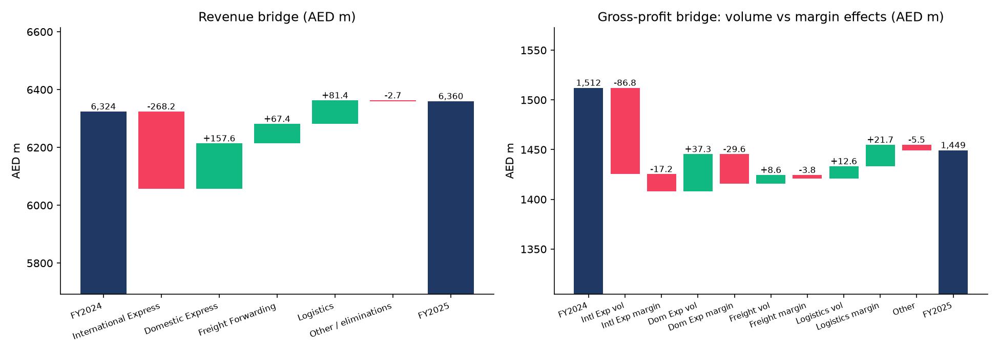
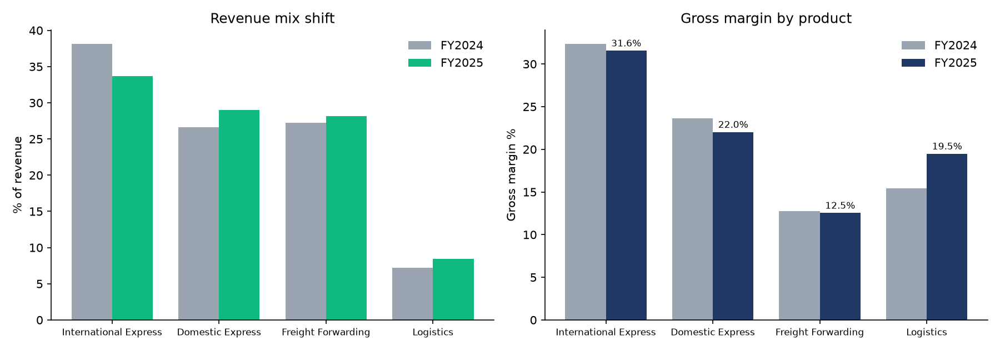
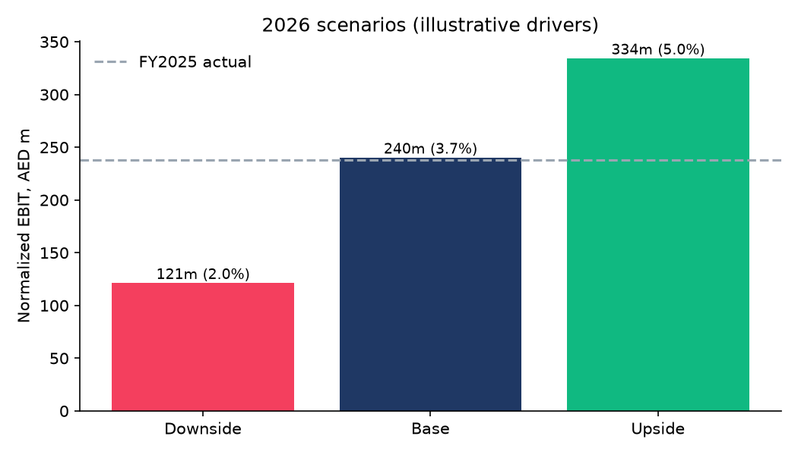

# Aramex FP&A Model: FY2025 Variance Analysis + 2026 Scenarios

An FP&A-style review of **Aramex PJSC (DFM: ARMX)**, the Dubai-listed logistics company, built from its **published FY2025 results**. It does what a finance team does after year-end: revenue and gross-profit bridges, a mix-vs-rate analysis of the margin drop, price-vs-volume for Express, one-off items, driver-based 2026 scenarios, an **Excel model with live formulas**, and an **auto-generated variance memo** where every number is computed, never typed.

**In plain terms:** Aramex's profit fell because its gross margin fell, not because costs rose (overheads were flat). 56% of the margin drop came from selling a less profitable mix, mainly less International Express, while Logistics added AED 34.3m of gross profit. The 2026 scenarios are my own illustrative assumptions.



## Key findings

| | |
|---|---|
| **Revenue** | AED 6,359.9m, +0.6%. International Express -AED 268.2m (-11%) offset by Domestic Express +157.6m, Logistics +81.4m, Freight +67.4m |
| **Gross margin** | 23.9% → 22.8%. Across the four products the margin fell 1.05 pp: **mix -0.59 pp (56%)** + **rate -0.46 pp** |
| **International Express** | Shipments -16% (28.1m → 23.6m) would have cut revenue by AED 386m; revenue per shipment AED 85.9 → 90.9 recovered 118m |
| **Logistics** | The profit engine: +AED 34.3m gross profit (12.6m from growth, 21.7m from margin 15.5% → 19.5%) |
| **Overheads** | Normalized overheads -0.3% (1,215.5m → 1,211.7m): the EBIT decline is a gross-profit problem, not a cost problem |
| **One-offs** | AED 45.0m of transformation and restructuring costs between normalized (237.7m) and reported EBIT (192.7m) |
| **2026 (illustrative)** | Normalized EBIT: downside 121m · base 240m · upside 334m |

Full memo: **[docs/variance_memo.md](docs/variance_memo.md)** · Excel model: **`outputs/aramex_fpa_model.xlsx`**



## Methods

- **Revenue bridge:** FY2024 → FY2025 by product (with an "Other / eliminations" line so products add up to the group).
- **Gross-profit bridge:** for each product, `volume effect = revenue change × last year's margin` and `margin effect = this year's revenue × margin change`. They add up exactly to the GP change (tested).
- **Mix vs rate:** the group margin change splits into **mix** (`Σ (share₂₅ − share₂₄) × margin₂₄`) and **rate** (`Σ share₂₅ × (margin₂₅ − margin₂₄)`).
- **Price vs volume (Express):** revenue change = shipment change × last year's revenue per shipment + this year's shipments × change in revenue per shipment. "Price" here includes mix within the product (weight, lanes, services).
- **Scenarios:** revenue growth and gross margin per product (yellow cells in the Excel model), normalized overheads held flat, other held at FY2025. **These are my illustrative assumptions, not company guidance.**



## The Excel model

`outputs/aramex_fpa_model.xlsx`, three sheets, all formulas live:

| Sheet | What it does |
|---|---|
| Inputs | Published figures (blue = transcribed input) |
| Bridge | Revenue and GP bridge with volume / margin effects and an OK/CHECK column |
| Scenarios | Edit growth and margin drivers (yellow) to get 2026 revenue, gross profit and normalized EBIT |

The workbook's formulas were evaluated independently and match the Python results to the dirham.

## Data quality

The figures were transcribed by hand from the press release, so **33 tests check every number against the margins and growth rates printed in the same release** (e.g. Domestic Express FY2025 margin must equal the printed 22.0%), check the printed Express subtotal, and check that every bridge adds up.

## Limitations

- One year-on-year comparison (FY2025 vs FY2024); a fuller model would add multiple years and the balance sheet and cash flow.
- Product-level data stops at gross profit; overheads are only available at group level.
- Scenario drivers are assumptions for illustration.
- This is an educational analysis of public information, not investment advice.

## Run it

```bash
python3 -m venv .venv && source .venv/bin/activate
pip install -r requirements.txt
./run_all.sh
```

## Source

Aramex PJSC, *Stable Revenues and Logistics Momentum Drive Aramex's 2025 Financial Performance, Supported by Strong Transformation Progress*, results press release, Dubai, 10 February 2026 (published on the Dubai Financial Market). Figures in `data/aramex_fy2025_fy2024.csv`; the PDF is not redistributed here.

## Tech

Python · pandas · openpyxl (Excel with live formulas) · matplotlib · pytest

Author: Abderrahmane Messaoudi, Industrial Engineering & Engineering Management, University of Sharjah · [LinkedIn](https://www.linkedin.com/in/abderrahmane-messaoudi-984161273/)
